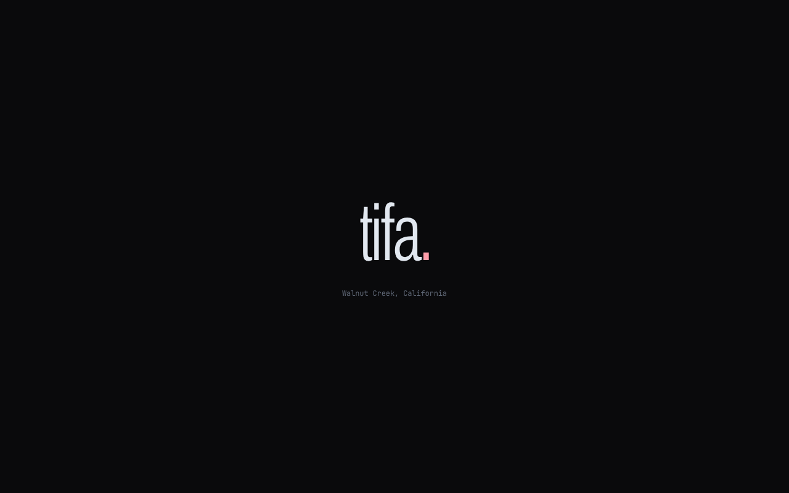
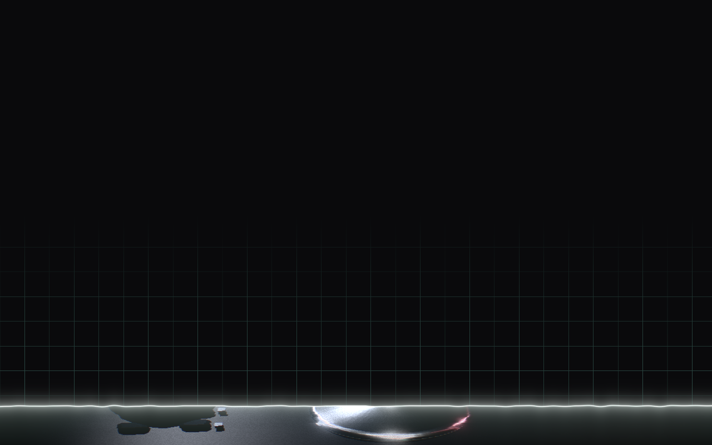
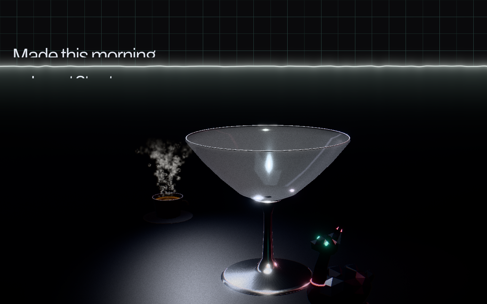
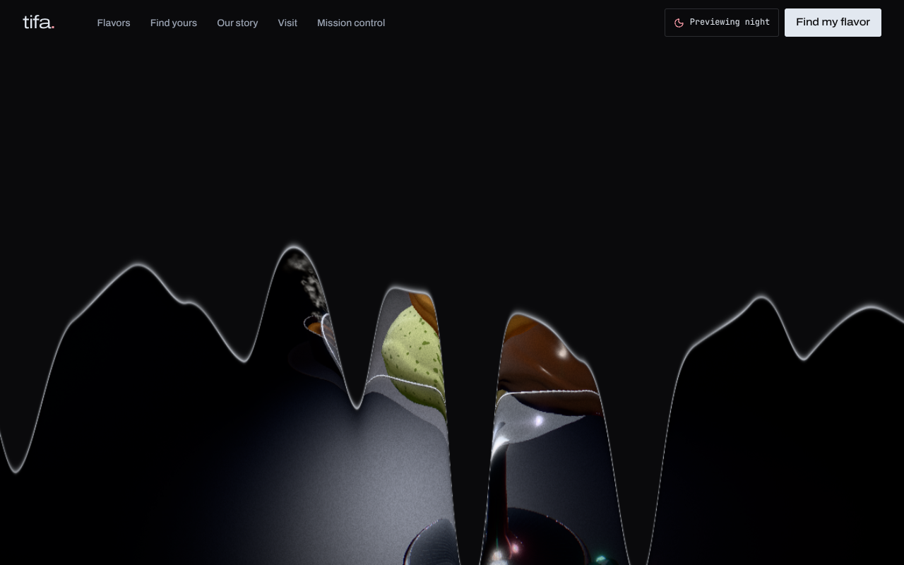
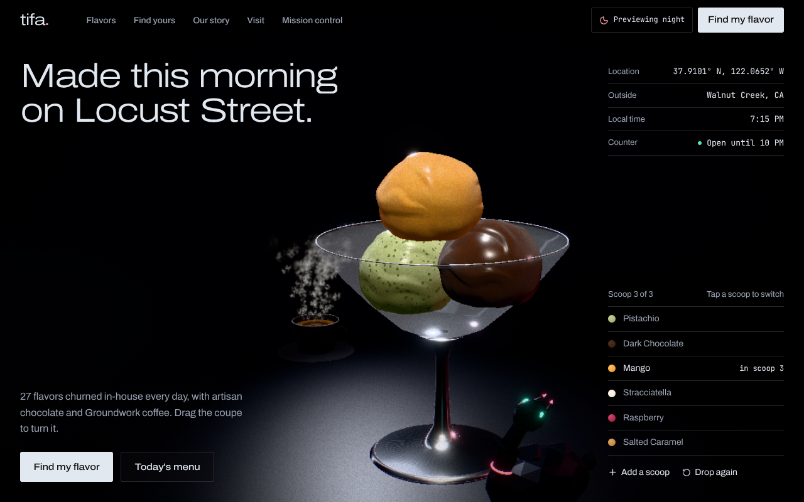
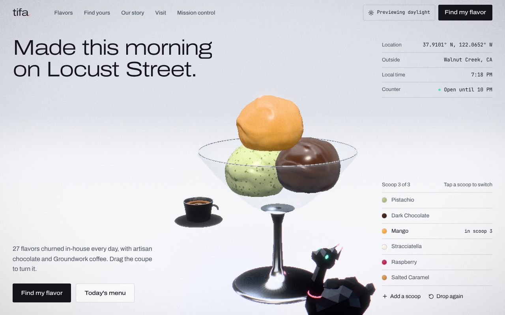
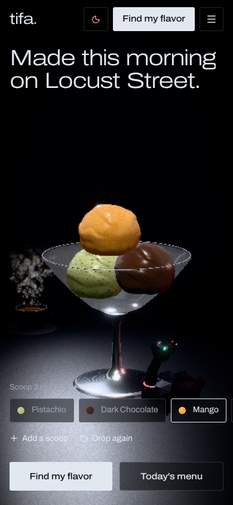
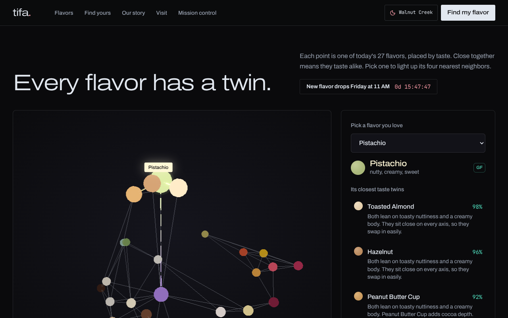
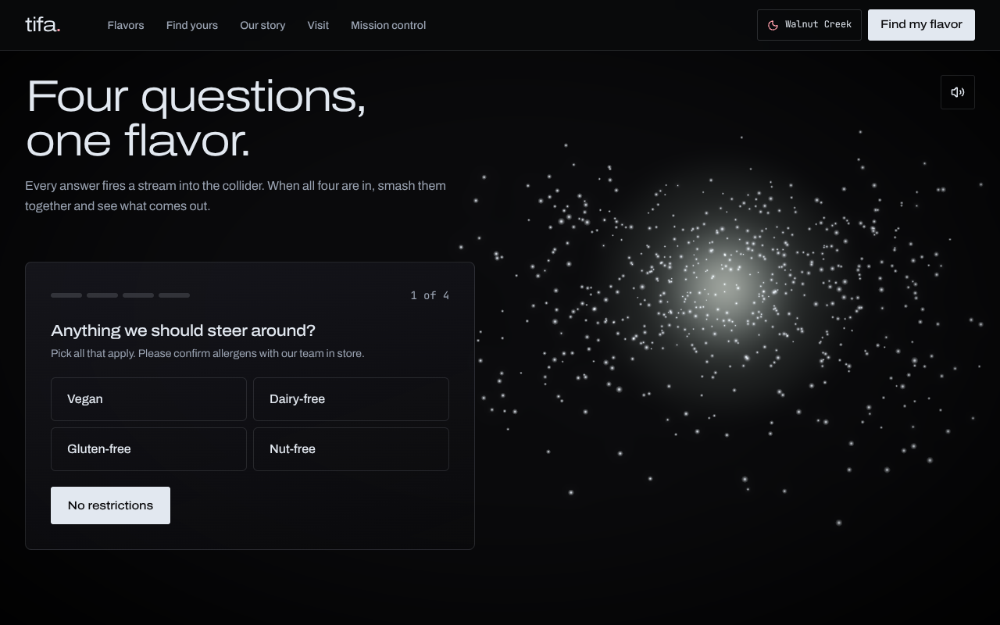

# Tifa Chocolate & Gelato — Walnut Creek flagship (v2)

A WebGL rebuild of [tifa-walnut-creek.vercel.app](https://tifa-walnut-creek.vercel.app): a "futuristic gelato laboratory meets cyberpunk lounge" site where the hero is a physics-driven scoop builder, the flavor quiz is a particle collider, flavor pairings are a 3D constellation, and the analytics section is a mission-control HUD.

**First visit:** the wordmark widens from condensed to expanded while the scene loads → a scan beam rises and "prints" the coupe from the base up over a construction grid → the scoops drop in → the headline stretches into place and the telemetry decodes. **Leaving the hero:** the scene melts away in obsidian drips with a mercury edge.

| 1 · Loading | 2 · Scan beam | 3 · Printing | Leaving: melt |
|---|---|---|---|
|  |  |  |  |

| Night | Daylight | Phone |
|---|---|---|
|  |  |  |

| Taste Twins | Particle Collider |
|---|---|
|  |  |

_Screenshots are from a headless software renderer at the **low** quality tier (no reflections, no transmission glass, no DoF). A real GPU on the high tier looks noticeably richer._

---

## Quick start

```bash
npm install
npm run dev          # http://localhost:3000
npm run build        # production build (passes clean)
npm run check        # matcher / taste-twins / layout sanity harness
```

Useful URL flags for demos and screenshots:

| Flag | Effect |
|---|---|
| `?quality=high\|mid\|low\|none` | Force a render tier (default: auto-detected, then adapted live) |
| `?weather=day\|night\|rain` | Force the lighting mode (default: live Walnut Creek weather) |
| `?intro=0` / `?intro=1` | Skip the intro / force the full intro (default: full on first visit, a short version on later visits in the same tab session) |
| `?introAt=2.2` | Freeze the intro at that second, for design review and screenshots |

Environment variables (all optional, see `.env.example`):

| Variable | Without it |
|---|---|
| `KV_REST_API_URL`, `KV_REST_API_TOKEN` (already set on the Vercel project by the KV integration; `UPSTASH_REDIS_REST_*` also accepted) | Dashboard shows a clearly labelled **sample data** banner; quiz tracking is skipped |
| `ANTHROPIC_API_KEY` (+ `ANTHROPIC_MODEL`) | Pairing/match notes use the deterministic, profile-derived sentences |

### Deploying on Vercel
`vercel.json` pins the framework to Next.js, so the existing `tifa-walnut-creek` Vercel project builds this branch correctly even though production is currently a static site. Every push to this branch gets its own **preview URL**; production only switches when the branch is merged into `main`. Vercel runs `next build` itself, so the GitHub web editor → auto-deploy workflow keeps working with no local toolchain.

The v2 dashboard writes under `tifa:v2:*` keys, so it never mixes with the current site's `tifa:*` analytics in the same database.

---

## Design direction

Luxury industrial, not candy. One typeface family (Archivo, variable width): headlines set **expanded and light** in the "Monument Extended" register, body at normal width, JetBrains Mono only for live telemetry. Controls are sharp (3 px), hairline-ruled, no glow; rose and mint are small accents only. The hero is a studio product shot: one coupe under an overhead pool light, strip-light reflections, film grain, the LaMa as a dark-chrome figurine with glowing eyes, Groundwork coffee in a matte black cup. The four corners carry the copy, real store telemetry (coordinates, live weather, local time, open status) and the scoop builder.

**Motion language:** one idea, used consistently: things *change width* (the wordmark, the hero headline, every section heading uses Archivo's width axis to stretch from condensed to expanded as it arrives), and the hero is solid on arrival (printed bottom-up) and liquid on departure (melts top-down). Everything else is user-driven. Reduced-motion users get none of it.

## Step-by-step technical execution plan

1. **Foundation** — Next.js 16 App Router, Tailwind v4 tokens (`app/globals.css`), self-hosted Syne + JetBrains Mono (no build-time font fetch), Zustand store (`lib/store.js`), store facts in one file (`lib/config.js`).
2. **Rendering budget first** — `lib/quality.js` picks a tier from the GPU/CPU/memory before first paint; drei `PerformanceMonitor` then lowers DPR or drops a tier live. Every canvas lazy-mounts near the viewport and sets `frameloop="never"` when off screen (`components/ui/useInView.js`).
3. **Hero scene** — scene graph, camera rig and post stack (`GelatoCanvas.jsx`), the procedural scoop shader (`shaders/gelatoMaterial.js`), Rapier stacking (`ScoopStack.jsx`), coupe (`Vessel.jsx`), steam (`CoffeeSteam.jsx`), mascot (`LlamaMascot.jsx`).
4. **Live environment** — Open-Meteo weather for Walnut Creek drives `day / night / rain` looks: background, fog, light rig, procedural env map and the rain-on-glass post effect (`shaders/RainEffect.jsx`). Falls back to the store clock if the API is unreachable.
5. **Arrival and departure** — pre-paint flag in `app/layout.jsx` (no flash), intro timeline in `components/ui/Hero.jsx` (`useIntro`, skippable by any input), shared render-free state in `lib/intro.js`, and one post effect for both the bottom-up print and the scroll melt (`shaders/TransitionEffect.jsx`). The hero is a sticky 175 svh section; scroll progress through it drives the copy fade, a camera push-in and the melt.
6. **Scroll & cursor layer** — Lenis on GSAP's ticker with ScrollTrigger synced; scroll-velocity text warp; fluid magnetic cursor; liquid-mercury dividers on a single shared WebGL canvas.
7. **Taste Twins** — PCA layout of the 8-D taste vectors (`lib/layout.js`), instanced constellation with synaptic threads (`FlavorConstellation.jsx`), accessible side panel and full menu (`FlavorsSection.jsx`).
8. **Particle Collider quiz** — deterministic matcher (`lib/matcher.js`), GPU vortex/streams/collapse/burst + reveal (`ParticleCollider.jsx`), spatial audio (`lib/audio.js`), shareable passport PNG (`lib/passport.js`).
9. **Mission control** — Upstash REST pipeline routes (`app/api/track`, `app/api/insights`), holographic terrain (`HoloTerrain.jsx`), HUD tiles and SVG charts with hover + keyboard tooltips and a table view (`TelemetryDashboard.jsx`, `charts.jsx`).
10. **Guarded AI** — `app/api/ai-note` writes one-sentence notes only; the flavor choice is always computed locally from the catalog.
11. **Verify** — `npm run build`, `npm run check`, headless screenshots of every section in all three weather modes and on a 390 px phone viewport.

---

## Architecture (maps to the brief's blueprint)

```
app/
  layout.jsx                  fonts, metadata, JSON-LD, SVG warp filters
  page.jsx                    → components/Experience.jsx
  api/track/route.js          POST quiz event → Upstash (validated, rate-limited)
  api/insights/route.js       GET dashboard aggregate (one pipeline round-trip)
  api/ai-note/route.js        guarded Claude notes (twins + quiz match)
components/
  canvas/GelatoCanvas.jsx     ★ R3F scene, camera rig, weather looks, post pipeline
  canvas/GelatoScoop.jsx      ★ procedural scoop mesh + jelly spring
  canvas/shaders/             ★ gelato SSS material, simplex noise, rain, print/melt transition
  canvas/ScoopStack.jsx       Rapier rigid bodies + scoop-stack cascade
  canvas/Vessel.jsx           lathed chrome/glass coupe + convex wall colliders
  canvas/CoffeeSteam.jsx      Groundwork cup + GPU steam
  canvas/LlamaMascot.jsx      ★ CCD inverse-kinematics neck, backflip, neon burst
  canvas/FlavorConstellation.jsx  ★ Taste Twins galaxy
  canvas/ParticleCollider.jsx ★ quiz vortex, energy core, shockwave, reveal
  canvas/HoloTerrain.jsx      Walnut Creek / Mt. Diablo hologram + beacon
  canvas/Anchor.jsx           pins DOM labels to 3D points
  ui/FlavorColliderQuiz.jsx   quiz overlay + passport
  ui/TelemetryDashboard.jsx   HUD dashboard
  ui/SmoothScrollProvider.jsx Lenis + GSAP + scroll warp
  ui/MercuryDividers.jsx      one-canvas liquid-metal dividers
  ui/FluidCursor.jsx, InertiaCard.jsx, Hero.jsx, Nav.jsx, …
lib/  flavors · matcher · layout · store · weather · quality · audio · passport · config
```

## How each brief feature is implemented

| Brief item | Implementation | Notes |
|---|---|---|
| 3D scoops with SSS, normal maps | `MeshPhysicalMaterial` + shader injection: vertex-sculpted scoop with analytic normals, procedural albedo (swirls, chips, nuts, seeds), derivative-based bump, real-time translucency term (wrap diffuse + distorted back-light + thin-edge glow) | SSS is a real-time approximation, not ray-marched. Flavor swaps cross-fade on the GPU; all scoops share one compiled program |
| Drag 360°, click to swap, physics "Scoop Stack" | Custom horizontal drag with inertia (keeps vertical swipes scrolling the page on phones), click-to-select scoop, flavor rack, Rapier rounded-cylinder bodies in a 22-slat convex coupe, impact-driven squash spring | Rapier chosen over Cannon (WASM, faster, maintained) |
| Groundwork steam | 1 `Points` draw call, motion is a pure function of (seed, time) in the vertex shader | Zero per-frame CPU or buffer uploads |
| LaMa mascot with IK, backflip, perk | 3-joint CCD IK with per-joint limits, cursor ray onto a camera-facing plane, idle wander; backflip arc + GPU neon burst + perk dialog with birthday-flavor picker | Keyboard/screen-reader users get a "Find the hidden LaMa" button |
| Live weather lighting, rain on glass | Open-Meteo → `day/night/rain`; lerped lights, fog, background, procedural Lightformer env; original screen-space rain shader (beads + runners refract the frame, fogged glass between) | Nav chip previews the other looks |
| Lenis, scroll warp, mercury dividers | Lenis driven by GSAP ticker, ScrollTrigger synced; `[data-warp]` headings get an SVG displacement + skew proportional to scroll speed; dividers ripple from cursor speed | DOM text warps via SVG `feDisplacementMap` instead of WebGL so headings stay real, selectable, indexable text |
| Particle Collider quiz | Four answer streams spiral in from compass points in their own colours, charge an energy core, implode, burst with a shockwave, reveal the matched scoop; synthesized HRTF spatial audio; passport PNG download + native share | Match is deterministic cosine similarity over the catalog, so it can never name an off-menu flavor |
| Taste Twins constellation | 27 nodes = 1 instanced draw call, ~70 edges = 1 line draw call, 4 animated synaptic threads; layout is PCA of taste profiles, so distance means taste distance | Twins + notes are also in an accessible side panel and plain menu list |
| Mission control | Upstash REST pipeline (plain fetch, no SDK); stat tiles, hour columns, 14-day line, top flavors, dietary share, latest matches; terrain hologram with a beacon that pulses on new quizzes | No visitor locations are collected, so the map shows the store, not users |
| Post-processing | Bloom (highlights only), chromatic aberration (driven by scroll speed), DoF (high tier), Neutral tone mapping, vignette, film grain, rain, print/melt transition | SSR isn't in the pmndrs stack; the high tier uses a planar `MeshReflectorMaterial` floor instead |
| "Unexpected" first visit | Width-axis wordmark loader, scan-beam print reveal with construction grid and slice jitter, camera crane from a macro shot of the stem, physics drop timed to the beam, stretch-in headline, decoding telemetry, scroll-driven melt | Plays fully once per tab session, shortened afterwards; any key, click, wheel or touch skips it |

## Performance strategy

- Tiered quality (`high / mid / low / none`) with live adaptation via `PerformanceMonitor`; low tier caps at 30 fps by driving a `demand` frameloop from a timer.
- Canvases are code-split, mount only near the viewport, and stop rendering when off screen; hero physics pauses too.
- GPU-side particle motion everywhere (steam, burst, vortex, terrain, halos) — the CPU updates a handful of uniforms per frame.
- Instancing and shared programs: one scoop shader for all scoops, one draw call for 27 nodes, one canvas for all dividers.
- No external 3D assets or HDRs: geometry and environments are procedural, so first paint needs no large downloads.
- `prefers-reduced-motion`: native scroll, no warp, no custom cursor, no auto-rotation, instant transitions.

## Before launch (needs the store)

- [ ] **Replace `lib/flavors.js` with the real 27 Walnut Creek flavors.** The current catalog is sample data so every system renders. Dietary tags must be verified by the store; the UI tells guests to confirm allergens in store.
- [ ] Re-run `npm run check` after the swap. With the sample catalog, 14 of 27 flavors are reachable as a quiz winner without filters (all 27 still appear in Taste Twins, runners-up and the menu). Tune the weights in `buildTarget()` against the real menu.
- [ ] Confirm the LaMa perk wording (`LAMA_PERK` in `lib/config.js`) and the birthday-flavor list (`components/ui/PerkOverlay.jsx`) with the owner.
- [ ] Add the Upstash env vars. v2 writes under `tifa:v2:*`, separate from the current site's keys, so history doesn't mix; migrate old totals if you want continuity.
- [ ] Optional: add `ANTHROPIC_API_KEY` for AI notes. Every note is validated server-side (must name the expected flavors, may not name any other catalog flavor, no dietary/health claims) and falls back to the deterministic note.
